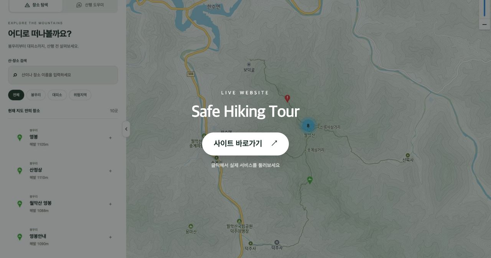
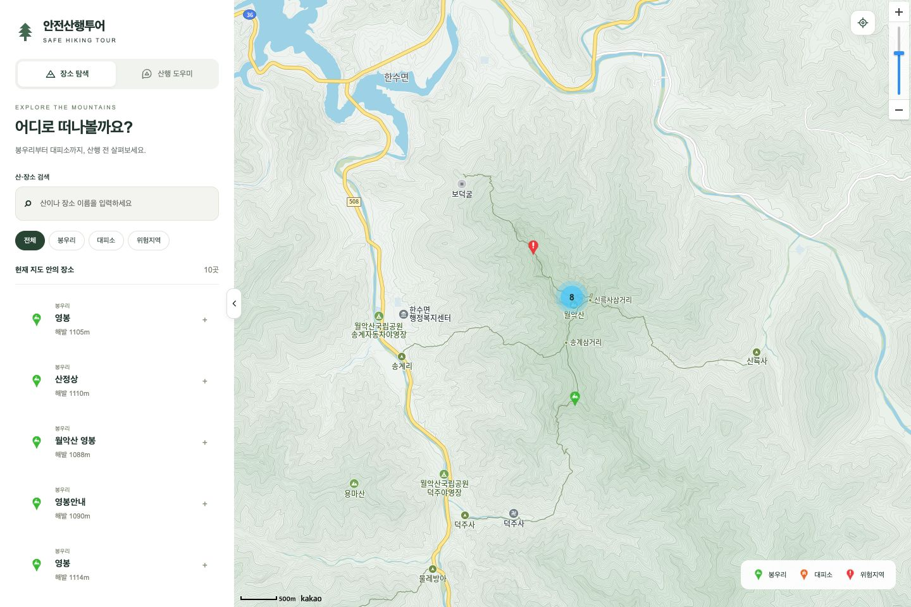
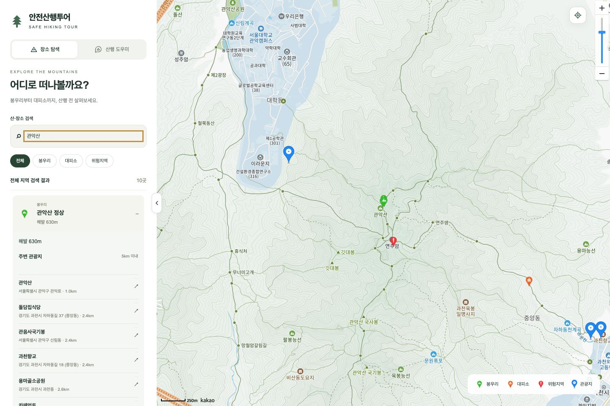
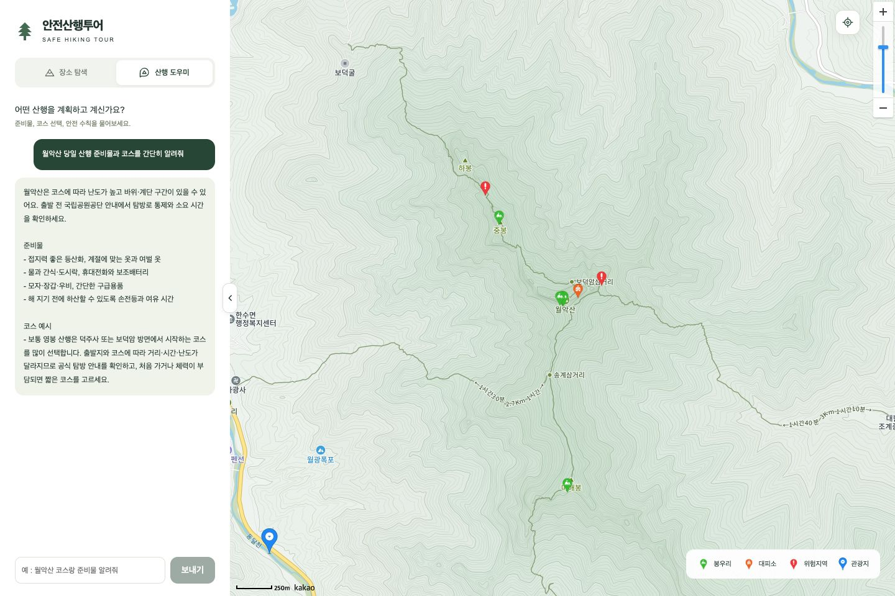
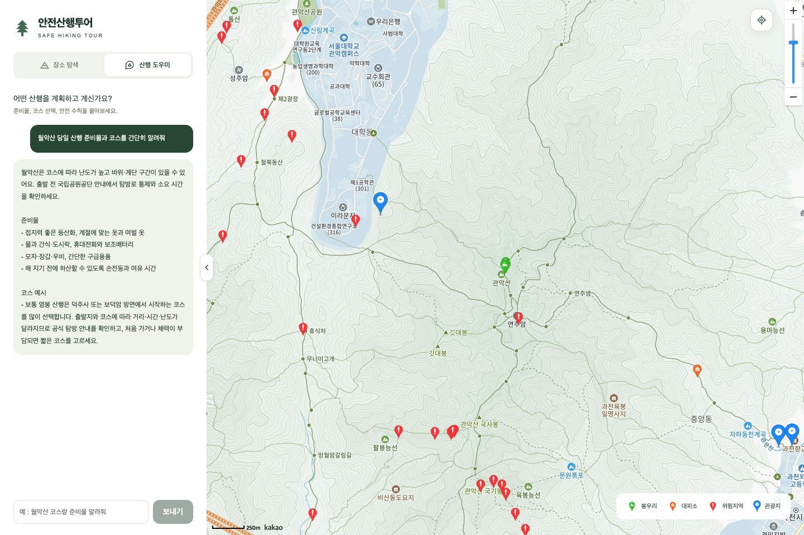

# ⛰️ Safe Hiking Tour

[](https://safe-hiking-tour.vercel.app)

등산 위험지역과 대피소·봉우리의 위치를 확인하는 웹 지도 서비스입니다.

## 📆 프로젝트 기간

- **초기 개발:** 2024.6 (React.js 기반)
- **업그레이드:** 2025.4 - 2025.5 (Next.js로 변경)
- **리뉴얼:** 2026.11 (지도 성능 최적화 및 공공데이터 갱신)

## 👨‍💻 역할

- 1인 개발 (Full-Stack Development)

## 🛠️ 사용 기술

- **Full-Stack**: Next.js 15.5.28, React 19, TypeScript
- **UI**: SCSS
- **지도**: Kakao Maps JavaScript API, 마커 클러스터링, 브라우저 Geolocation API
- **AI**: OpenAI Responses API (`gpt-6-luna`)
- **공공데이터**: 한국관광공사 TourAPI, 한국등산·트레킹지원센터 위험지역 POI

## 🚀 섹션별 설명

- **위험지역 지도**: 위험지역 3,789곳·대피소 121곳·봉우리 960곳의 위치를 구분해 표시합니다. 현재 지도 안의 장소를 목록에서도 확인하고, 장소 유형별로 필터링할 수 있습니다. 검색은 지도 범위에 관계없이 전체 지역을 대상으로 하며, 목록을 누르면 해당 위치로 이동합니다. 추가로 주변 관광지를 함께 노출합니다.



### 위험지역 표출 최적화

전국 4,870곳의 마커를 한꺼번에 만들던 방식을 **화면 범위에 따른 생성·재사용·일괄 갱신**으로 변경했습니다.

| 항목 | 이전 | 이후 | 효용 |
| --- | --- | --- | --- |
| 마커 생성 | 전국의 모든 장소를 즉시 생성 | 화면 경계에서 25%씩 여유를 둔 영역만 생성 | 초기 객체 생성량 감소 |
| 마커 이미지 | 장소마다 50px 이미지 객체 생성 | 유형별 이미지 3개를 공유하고 28px로 표시 | 이미지 객체 중복 생성 제거 |
| 지도 갱신 | 개별 마커를 지도에 직접 등록 | 이동 완료 후 변경분을 모아 한 번에 갱신 | 이동 중 갱신 부담 감소 |
| 밀집 지역 | 개별 마커가 겹쳐 표시 | 축소 화면에서 클러스터로 묶어 표시 | 마커 겹침과 개별 이미지 DOM 감소 |
| 재방문 | 전국 마커를 계속 보유 | 방문한 영역의 마커를 캐시해 재사용 | 전체 마커를 미리 생성하지 않고 재방문 처리 |

전체 좌표 데이터는 유지해 지도 밖의 장소도 검색합니다. 좌표 검사는 전체 배열을 순회하며, 최적화의 주된 효과는 마커 객체 생성과 DOM 갱신량 감소입니다.

### 이전·이후 실측

같은 데이터 4,870건과 카카오 SDK로 기존 커밋의 표출 로직을 재현하고 현재 로직과 비교했습니다. **월악산 초기 화면, 지도 1000 × 600px, 각 방식 5회 반복** 기준입니다.

| 지표 | 이전 | 이후 | 변화 |
| --- | ---: | ---: | ---: |
| 초기 생성 마커 | 4,870개 | 10개 | 99.8% 감소 |
| 초기 마커 등록 시간 | 610.3ms | 5.8ms | 99.0% 감소 |
| 지도 이동 · 2rAF 중앙값 | 19.0ms | 4.8ms | 75.0% 감소 |
| 확대·축소 · 2rAF 중앙값 | 50.9ms | 21.2ms | 58.4% 감소 |
| 확대·축소 · 2rAF P95 | 60.5ms | 109.4ms | 80.8% 증가 |

초기 마커 생성량은 **99.8%**, 초기 등록 시간은 **99.0%** 줄었습니다. 다만 데스크톱의 확대·축소 P95는 증가했습니다. 넓은 영역을 처음 표시할 때 새 마커를 생성하는 비용이 발생하기 때문입니다.

2rAF는 지도 조작부터 두 번째 `requestAnimationFrame` 콜백까지의 시간입니다. 페이지 전체 로딩 속도나 실제 사용자 INP와는 다른 측정값입니다. 375px 모바일 폭에서도 측정했으며 실제 휴대폰 성능을 뜻하지 않습니다. [측정 조건·전체 결과](docs/performance/map-performance.md)

- **봉우리 주변 관광지**: 봉우리 항목을 펼치면 5km 이내 관광지와 지도 마커를 확인할 수 있습니다. 위험지역·대피소에서는 관광정보를 조회하지 않고 해당 장소 설명만 표시합니다.



- **AI 산행 도우미**: 산행 코스와 준비물에 관한 질문에 답변합니다.



- **모바일 화면**: 지도와 패널을 위·아래로 배치하고 패널 접기·펼치기를 지원합니다.



## 📌 설치 및 실행 방법

```sh
# 1. 프로젝트 클론
git clone https://github.com/moonjiuk/safe-hiking-tour.git
cd safe-hiking-tour

# 2. 패키지와 환경변수 준비
npm ci
cp .env.example .env.local

# 3. 개발 서버 실행
npm run dev
```

로컬 주소는 `http://localhost:3000`입니다. 카카오 개발자 콘솔에 사용할 도메인을 등록해야 합니다.

| 환경변수 | 용도 |
| --- | --- |
| `NEXT_PUBLIC_KAKAO_API_KEY` | 카카오 JavaScript 키. 로컬·운영 도메인 등록 필요 |
| `TOURISM_API_KEY` | TourAPI 서비스 키 |
| `OPENAI_API_KEY` | OpenAI Responses API 키 |
| `OPENAI_MODEL` | 기본 모델 `gpt-6-luna` |
| `HIKING_API_KEY` | 위험지역 데이터 갱신용 서비스 키 |

```sh
# 정적 검사와 운영 빌드
npm run lint
npm run build
npm start
```

## 📊 데이터 기준과 갱신

위험지역·대피소는 2026-11-01 공식 API 제공분을 반영했습니다. 수집 시각과 원본 기준시각을 분리해 기록합니다.

원본: [전국주요봉우리 위험지역 POI 정보 서비스](https://www.data.go.kr/data/15108067/openapi.do)

```sh
# 전체 데이터 수집·검증 후 변경 내역 확인
node --env-file=.env.local scripts/refresh-risk-data.mjs

# 검증된 데이터와 수집 메타데이터 반영
node --env-file=.env.local scripts/refresh-risk-data.mjs --apply
```

좌표·중복 ID·수집 누락을 검증하고, 데이터가 20% 이상 급감하면 기존 파일을 보존합니다.
